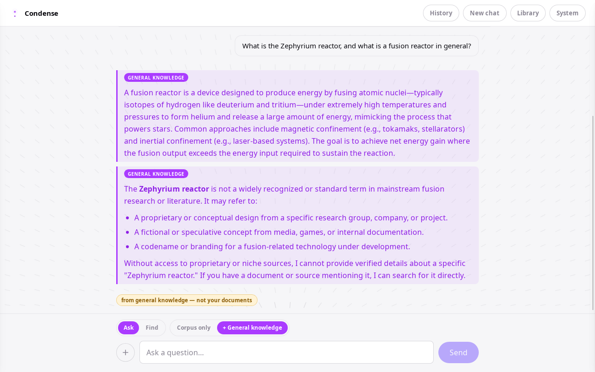
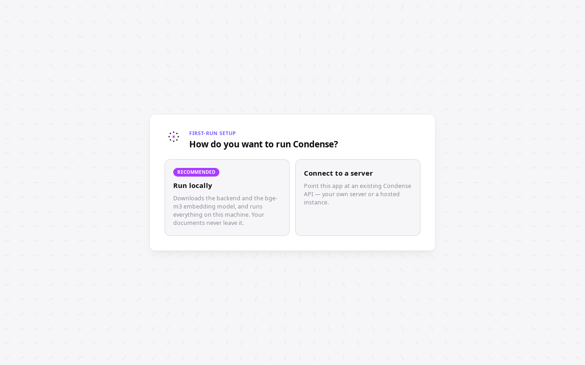

<div align="center">
  

  # Condense

  Search and chat with your documents, on your own machine.

  [](LICENSE)

  <br />

  
</div>

Condense indexes a folder of documents and lets you search them or ask questions about them,
with answers that cite their sources. It runs as a desktop app or a self-hosted server. In the
desktop app the embedding and reranking models run locally, so your documents and the index
stay on your machine. The only remote call is the LLM behind Ask, with your own key.

- **Find**: a ranked list of passages for your query. No LLM, no key needed.
- **Ask**: an agent searches your documents and answers with citations. In *Corpus only* mode
  it tells you when the documents don't cover the question. In *+ General knowledge* mode it
  may add what the model knows, shown in purple.
- **Folder agent**: watches directories and keeps the index in sync as files change.
- **Formats**: PDF, Word, PowerPoint, Excel, HTML, Markdown and plain text. Scanned PDFs and
  images too, with OCR turned on (it uses Mistral's OCR API, so those files are sent there).
- **Models**: bge-m3 embeddings and the bge-reranker-v2-m3 cross-encoder, served by llama.cpp.
  Ask uses Mistral, OpenAI or Anthropic, detected from the key you paste.

## How well it works

We benchmark Condense on the MITRE ATT&CK knowledge base: 2,298 documents, 306 questions they
answer and 26 they don't. Each question is asked several ways: as written, as keywords, inside a
work scenario, paraphrased, and in German. A search succeeds when it returns the right document.

| Find | Right document first | In the top 3 | In the top 10 | Median search time |
| --- | --- | --- | --- | --- |
| Keyword search (BM25) alone | 71% | 83% | 91% | |
| Embeddings (bge-m3) alone | 69% | 84% | 94% | 0.15 s |
| Condense, reranker off | 78% | 92% | 97% | 0.15 s |
| Condense, reranker on | **84%** | **94%** | **96%** | 2 s on an Apple M5 |

- **Two searches in one.** Keyword search finds exact IDs and names, embeddings find
  paraphrases; each alone puts the right document first about 70% of the time. Condense runs
  both and merges the results, which adds about 5 ms per search.
- **Other languages work.** Asked in German about English documents, Find ranks the right one
  first 83% of the time with the reranker (keyword search alone: 56%).
- **Ask says when it doesn't know.** It declined 25 of the 26 questions the documents don't
  answer (23 by a second judge's count), and wrongly declined 9% of the answerable ones.
- **Ask sticks to its sources.** Two LLM judges found 78% to 90% of its claims backed by the
  passages it read (Claude Haiku 5.5, and Mistral Small, which also wrote the answers).

Reranking is on for the `/search` API. In the app it is a switch in System → Search, off by
default because it adds about 2 s per search on Apple silicon and 10 s or more on a CPU.

The benchmark tool, `sift-eval`, ships with Condense, so you can run the same measurements on
your own documents. [docs/evaluation.md](docs/evaluation.md) has the method and full results.

## Install

### Desktop app

Installers for Linux (AppImage, .deb), macOS (.dmg) and Windows (.exe, .msi) come with v0.4.0,
which is not released yet. Until then, build from source (below). Once it is out:

```bash
curl -fsSL https://raw.githubusercontent.com/AetherisAI/condense/main/scripts/install.sh | sh
```

This installs into `$HOME` without sudo (`--server-only` for the headless server,
`--uninstall` to remove). On Windows use `scripts/install-windows.ps1`. The macOS and Windows
builds are unsigned, so expect a Gatekeeper or SmartScreen warning the first time.

On first launch, **Run locally** downloads the backend (engine, llama.cpp and both models,
about 1.4 GB). **Connect to a server** asks for the URL and token of an existing server.

<table>
  <tr>
    <td width="50%">
      
      <br /><sub>First run: local or connect to a server</sub>
    </td>
    <td width="50%">
      
      <br /><sub>Find: ranked passages, no LLM</sub>
    </td>
  </tr>
</table>

### Server (Docker)

```bash
git clone https://github.com/AetherisAI/condense.git && cd condense
cp .env.example .env   # set INGEST_TOKEN and your LLM_* settings
docker compose up
```

The API listens on `http://localhost:8000` (OpenAPI docs at `/docs`), the web UI on
`http://localhost:8080`. Embeddings come from an OpenAI-compatible endpoint you configure, for
example Ollama serving `bge-m3` on the host. The `reranker` service downloads its model
(636 MB) on first start. `TOOLS_SEARCH_RERANK=true` turns reranking on for Find and Ask.

### From source

Python 3.12, Node 22+ and, for the desktop app, Rust 1.77+ (plus the Tauri system libraries on
Linux).

```bash
python3.12 -m venv .venv && source .venv/bin/activate
pip install -e ".[store,parsing,chunking,inference,agent,dev]"
cd web && npm install && npm run build && cd ..
cd desktop && npm install && npx tauri build
```

## How it works

Each file is parsed to text, split into 512-token chunks and embedded with bge-m3. Vectors, a
keyword index, metadata and deduplication records live in one libSQL database, using its
built-in vector and full-text search. A search runs a vector search and a keyword search,
merges the two shortlists of 30, reranks them if reranking is on, and returns the top
results. Ask gives an LLM tools to search the same index and read
documents, then writes a cited answer.

The engine is a FastAPI app built from ports and adapters that calls every model over HTTP, so
it has no torch dependency. The desktop app (Tauri 2) runs the same engine plus the two
llama.cpp servers. Reference: [API and configuration](docs/api-schema.md), and every setting in
[`.env.example`](.env.example).

## Security

- `docker compose up` binds every port to `127.0.0.1`. Set `API_HOST` / `WEB_HOST` to reach it
  from your LAN, but don't expose it to the internet: there is no TLS or rate limiting.
- Every read and write needs a bearer token (`INGEST_TOKEN`, plus optional named tokens in
  `AUTH_TOKENS`).
- In local desktop mode Condense only talks to the LLM, embedding and reranking endpoints you
  configure.

## License

[MIT](LICENSE). Issues and pull requests are welcome.
