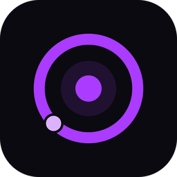
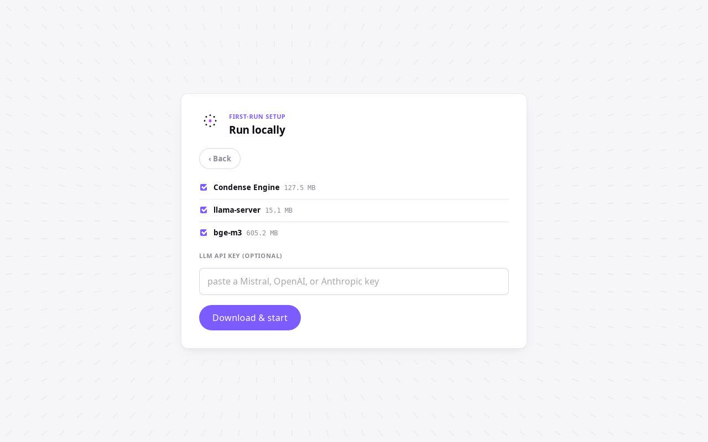
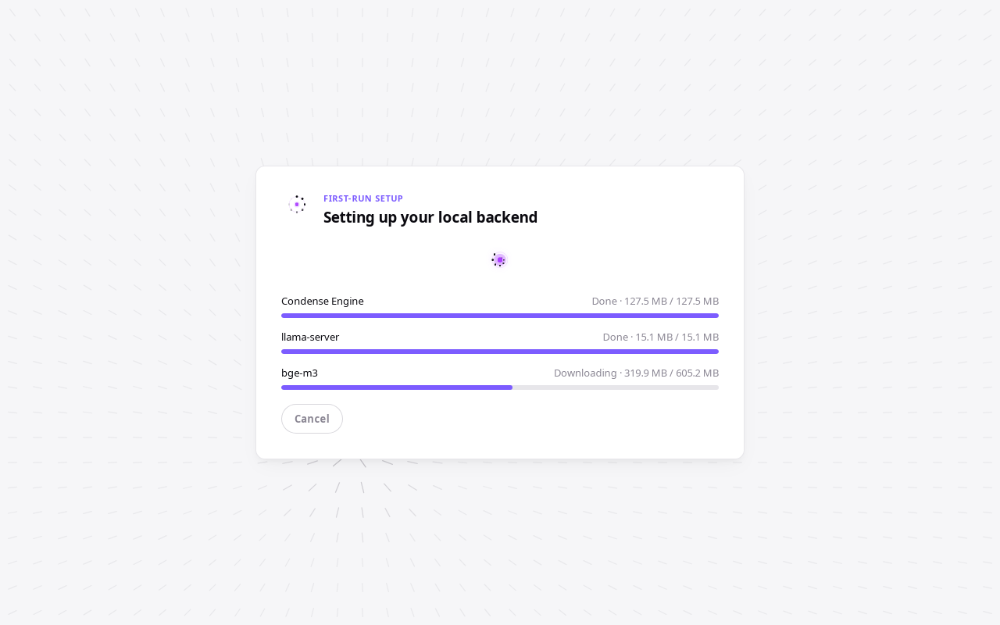
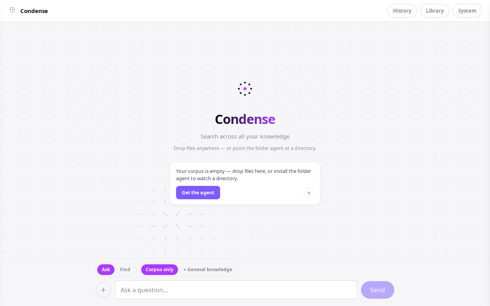
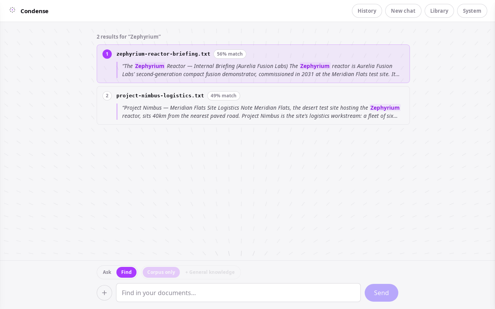

<div align="center">
  

  # Condense

  Chat with your documents, locally.

  [](LICENSE)

  <br />

  
</div>

Condense indexes a folder of documents and lets you search them or ask questions about them.
Answers cite the passages they came from. It runs as a desktop app or as a self-hosted server,
your documents stay on your machine, and you bring your own LLM key.

- **Ask**: an agent searches your documents and answers with citations. In *Corpus only* mode
  it says so when the documents don't cover the question. In *+ General knowledge* mode it may
  add what the model knows, and that part is shown in purple.
- **Find**: plain retrieval, a ranked list of passages, no LLM involved.
- **Folder agent**: watches directories and keeps the index in sync as files change.
- **Local models**: bge-m3 embeddings and the bge-reranker-v2-m3 cross-encoder run on your
  machine through llama.cpp. Only the LLM is remote (Mistral, OpenAI or Anthropic; the provider
  is detected from the key). Find works without any key.

## Screenshots

<table>
  <tr>
    <td width="50%">
      
      <br /><sub>First run: local or connect to a server</sub>
    </td>
    <td width="50%">
      
      <br /><sub>Components to download, LLM key optional</sub>
    </td>
  </tr>
  <tr>
    <td width="50%">
      
      <br /><sub>Downloading the local backend</sub>
    </td>
    <td width="50%">
      
      <br /><sub>Drop files anywhere, or point the folder agent at a directory</sub>
    </td>
  </tr>
  <tr>
    <td colspan="2" align="center">
      
      <br /><sub>Find mode</sub>
    </td>
  </tr>
</table>

## Install

### Desktop app

Desktop installers (AppImage and .deb for Linux, .dmg for macOS, .exe/.msi for Windows) are
attached to each release starting with v0.4.0. Once it's out:

```bash
curl -fsSL https://raw.githubusercontent.com/AetherisAI/condense/main/scripts/install.sh | sh
```

This installs into `$HOME` without sudo. `--server-only` installs the headless server bundle
instead, `--uninstall` removes either. On Windows use `scripts/install-windows.ps1`. The macOS
and Windows builds are unsigned, so expect a Gatekeeper or SmartScreen warning the first time.
Until v0.4.0 is tagged, build from source (below).

On first launch, choose **Run locally** and the app downloads its backend: the engine, a
llama.cpp build, the bge-m3 embedding model and the bge-reranker-v2-m3 reranker, about 1.4 GB.
Or choose **Connect to a server** and give it the URL and token of an existing Condense server.

Reranking is on for the `/search` API. For Find and Ask it is a switch in System → Search, off by
default because it adds about 2 s per search on Apple silicon and more on machines without a
GPU. On a MITRE ATT&CK benchmark it raised top-1 accuracy from 0.69 to 0.82
(see [docs/evaluation.md](docs/evaluation.md)).

### Server (Docker)

```bash
git clone https://github.com/AetherisAI/condense.git && cd condense
cp .env.example .env   # set INGEST_TOKEN and your LLM_* settings
docker compose up
```

The API listens on `http://localhost:8000` (OpenAPI docs at `/docs`) and the web UI on
`http://localhost:8080`. Embeddings come from an OpenAI-compatible endpoint you configure,
for example Ollama serving `bge-m3` on the host. The `reranker` service downloads its model
(about 636 MB) on first start. `TOOLS_SEARCH_RERANK=true` turns on reranking for Find and Ask.
On a machine with a CUDA GPU, `docker compose --profile tei up` with
`RERANK_BASE_URL=http://tei:80` serves the same reranker through Text Embeddings Inference.

### From source

You need Python 3.12, Node 22+ and, for the desktop app, Rust 1.77+ (plus the Tauri system
libraries on Linux, or the Docker builder in `desktop/`).

```bash
python3.12 -m venv .venv && source .venv/bin/activate
pip install -e ".[store,parsing,chunking,inference,agent,dev]"
cd web && npm install && npm run build && cd ..
cd desktop && npm install && npx tauri build
```

## How it works

The engine is a FastAPI app built from ports and adapters: pipelines talk to interfaces for the
embedder, reranker, LLM and vector store, and `src/sift/factory.py` wires the concrete adapters
from one typed `Settings` object. Vectors, metadata and deduplication live in a single libSQL
database using its built-in vector search. All model inference happens over HTTP, so the engine
itself doesn't depend on torch. The desktop app (Tauri 2) runs the same engine and supervises
the two llama.cpp servers; the Docker setup runs the same engine in a container.

```
src/sift/   engine: core types and ports, adapters, pipelines, API, eval harness
web/        React + Vite UI
agent/      folder-watching ingestion agent
desktop/    Tauri desktop app
packaging/  PyInstaller specs for the engine and agent bundles
evals/      evaluation golden-set example and the CI retrieval benchmark
docs/       API reference, evaluation guide, images
```

Reference: [API and configuration](docs/api-schema.md) ·
[Evaluation with `sift-eval`](docs/evaluation.md) · every setting is listed in
[`.env.example`](.env.example).

## Security

- `docker compose up` publishes every port on `127.0.0.1` only. To reach it from your LAN, set
  `API_HOST` / `WEB_HOST` to `0.0.0.0` or an interface address. Don't expose it to the public
  internet: there is no TLS or rate limiting.
- A bearer token (`INGEST_TOKEN`, plus optional named tokens in `AUTH_TOKENS`) is required for
  every read and write.
- In local desktop mode your documents, their embeddings and the database stay on your machine.
  Condense only talks to the embedding, reranking and LLM endpoints you configure.

## License

[MIT](LICENSE). Issues and pull requests are welcome.
